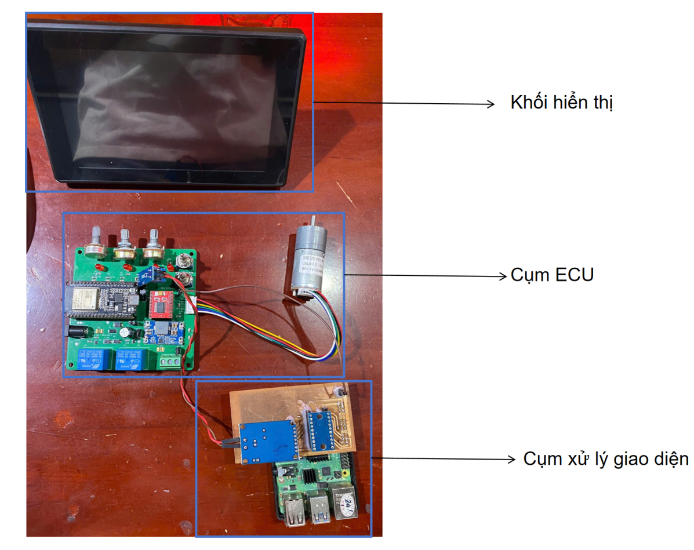
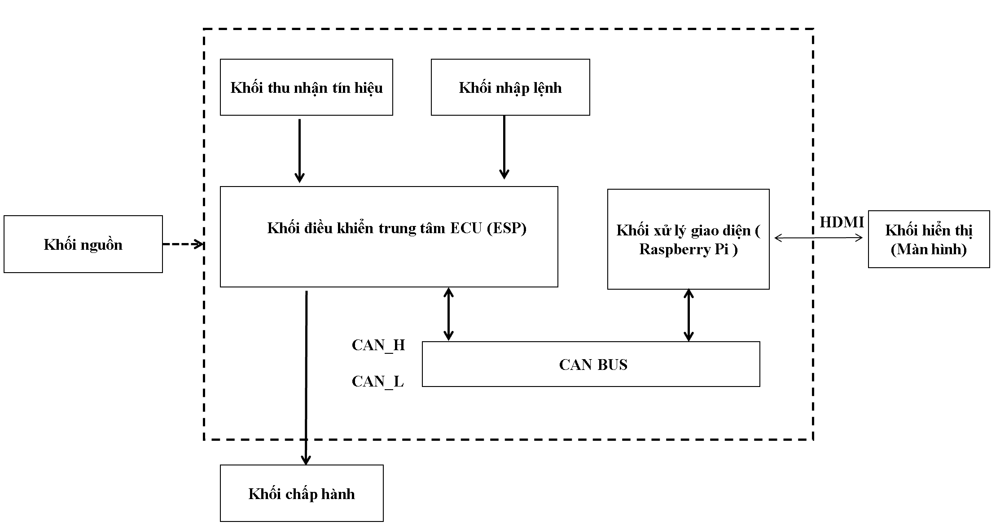
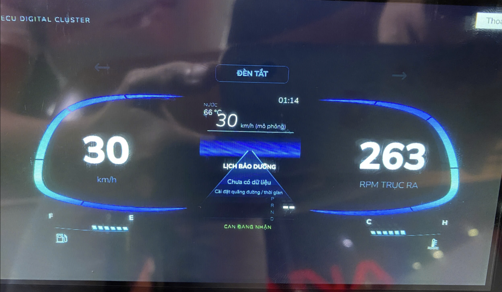
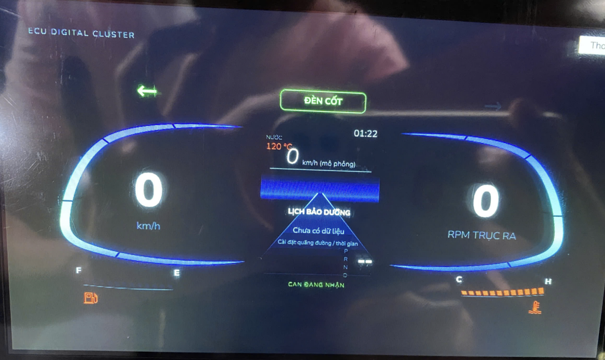
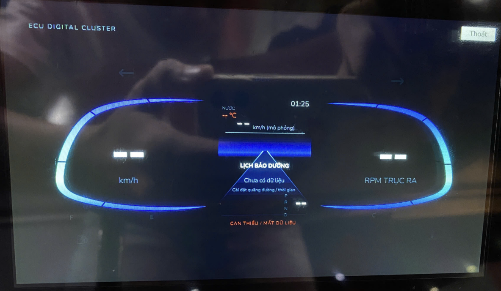

# ESP32 Automotive ECU and Digital Cluster

A two-node embedded prototype connecting an ESP32 ECU simulator to a Raspberry Pi 4 digital instrument cluster over **500 kbit/s CAN**. Built as a team university project by **Nguyen Duc Phuong and Nguyen Minh Khang**.

## What it does

- **ESP32 / C++:** ADC throttle input, PWM DC-motor control, interrupt-based encoder measurement, turn signals and relay-controlled headlights.
- **CAN:** three periodic status frames, non-blocking transmission, transmit-queue failure counting and bus-off recovery logic.
- **Raspberry Pi / C++ / Qt QML:** Linux SocketCAN reception, frame validation, RPM and simulated speed display, lighting indicators and fuel/temperature warnings.
- **Missing-data detection:** each message group becomes invalid after 1,000 ms without a valid frame; a timer checks every 100 ms.

## System

| ECU node | Cluster node |
| --- | --- |
| ESP32 DevKit, SN65HVD230 CAN transceiver | Raspberry Pi 4, MCP2515 CAN module and logic-level interface |
| JGA25-370 motor/encoder, TB6612FNG motor driver | Linux SocketCAN, C++ and Qt/QML |
| Potentiometers, switches, LEDs and relays | 7-inch 1024 × 600 HDMI display |

Fuel and coolant temperature are simulated with potentiometers. Vehicle speed is calculated from encoder RPM using an assumed wheel diameter; the motor is not connected to a vehicle drivetrain.

## CAN messages

Standard 11-bit identifiers; ECU to cluster. Multi-byte RPM is little-endian.

| ID | DLC | Period | Payload |
| --- | --- | --- | --- |
| `0x100` | 4 | 50 ms | B0–B1: RPM × 10; B2: throttle 0–100%; B3: direction `0x01` / `0xFF` |
| `0x101` | 2 | 100 ms | B0: fuel 0–100%; B1: simulated coolant 20–120 °C |
| `0x102` | 2 | 100 ms | B0: turn signal 0/off, 1/left, 2/right; B1: lamps 0/off, 1/low, 2/high |

## Demonstrated results

Chapter 4 of the team report documents these hardware demonstrations. They are qualitative observations, not measured latency, reliability or automotive qualification results.

| Scenario | Reported observation |
| --- | --- |
| Adjust throttle and simulated sensor inputs | Motor/encoder values and dashboard readings change with the inputs |
| Select lights and warning conditions | Turn/headlight indicators and warning colors update |
| Disconnect CAN | Dashboard replaces unavailable values with `--` and displays a missing-data warning |

| Normal operation | Lighting and warnings | CAN disconnected |
| --- | --- | --- |
|  |  |  |

## Repository

- [`firmware/`](firmware/) — ESP32 application, peripheral modules and PlatformIO configuration.
- [`cluster/`](cluster/) — Qt/QML dashboard and C++ SocketCAN receiver.
- [`docs/setup.md`](docs/setup.md) — build and hardware setup notes.
- [`docs/images/SOURCES.md`](docs/images/SOURCES.md) — report figure provenance.

## Scope and credits

This is an educational bench prototype with a custom CAN payload format. It has not been validated on a real vehicle, does not implement closed-loop motor-speed regulation, and does not demonstrate automotive environmental or safety compliance. CAN bus-off recovery is present in the code; the report's disconnected-display demonstration is not a timed recovery benchmark.

Documentation and result images are based on the team's report **DA2_V1.1**, “Thiết kế và thi công bảng đồng hồ kĩ thuật số và kết hợp mô phỏng ECU” (2026). Source snapshots were supplied with the project; the report identifies the team's original repositories:

- [ESP32 ECU firmware — codebykhang](https://github.com/codebykhang/esp32-automotive-ecu)
- [Digital cluster — codebykhang](https://github.com/codebykhang/Cluster_Automotive)

This portfolio repository brings the two components and report results together, retaining team attribution.
